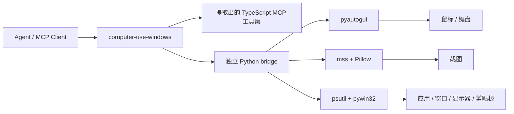

# Windows Computer-Use Skill 0.1.1

## 项目定位

这个项目完全本地化，同时是：

- 一个顶级 `skill`
- 一套独立的 Windows 桌面控制 runtime
- 一个给 agent 生态使用的 computer-use MCP server

它是 skill-first，客户端无关，可对接任意 agent 产品。

## 这个项目解决什么问题

- 不依赖任何特定 agent 客户端的本机应用
- 不依赖私有 `.node` 二进制
- 不依赖提取内部隐藏资产
- skill 装上、server 构建好，就能直接用

## 你现在拿到的能力

- 顶级 Windows computer-use skill
- 独立 MCP server：截图、鼠标、键盘、应用启动、窗口/显示器映射、剪贴板
- 只使用公开依赖：`Node.js + Python + pyautogui + mss + Pillow + psutil + pywin32`
- 首次运行自动自举：自动创建虚拟环境并安装 Python 依赖
- 提取出来的 TypeScript 工具层已经接到 Windows 原生 Python backend

## Windows 实机验证结果

以下已在真实 Windows 机器上端到端验证通过：

- TypeScript 构建（`npm run build`）与类型检查（`npm run check`）
- Python venv 自举链路（首次运行自动创建 `.runtime/venv` 并安装依赖）
- Python helper 只读能力实测：权限检查、显示器枚举（2560x1600 x3）、截图采集（内容正确）、前台应用识别、光标位置、应用枚举
- MCP stdio 握手、`tools/list`、权限门控（未授权时截图被正确拒绝并提示先调 `request_access`）
- 实操链路：窗口激活、`left_click` 点击落点（150% DPI 缩放下坐标换算正确）、键盘组合键、Unicode 文本输入（空格/中文/全角标点完整）
- UAC / 管理员窗口：提权窗口可正确识别、截图与窗口管理正常；非提权 runtime 注入的输入被 Windows UIPI 拦截，helper 会显式报错并提示以管理员运行 runtime
- 混合 DPI 场景, 多屏不同缩放验证通过

## 架构



## MCP 配置

```json
{
  "mcpServers": {
    "computer-use-windows": {
      "command": "node",
      "args": [
        "C:/Users/<user>/.agents/skills/computer-use-windows/project/dist/cli.js"
      ],
      "env": {
        "COMPUTER_USE_DEBUG": "0",
        "COMPUTER_USE_COORDINATE_MODE": "pixels"
      }
    }
  }
}
```

### 打包分发

```bash
cd scripts
python package_skill.py            # 生成 computer-use-windows.zip
```

## 运行说明

### 权限

Windows 不像 macOS 那样需要 Accessibility / Screen Recording 授权弹窗，但仍可能受这些因素限制：

- agent 进程不是管理员，而目标窗口是管理员权限（UIPI 会拦截输入注入，helper 会显式报错）
- UAC 安全桌面切换
- 会话 / 远程桌面边界
- 应用自身的反自动化限制

### 截图过滤

当前 runtime 声明的是 `screenshotFiltering: none`。

也就是说，截图过滤不是 compositor 原生级别，动作 gating 仍由 MCP 层处理。

### 平台范围

当前项目明确是 `Windows-only`。

覆盖能力：

- 截图
- 鼠标控制
- 键盘输入
- 前台应用识别
- 已安装 / 运行中应用发现
- 窗口到显示器映射
- 剪贴板访问
- 应用启动

## 项目结构

```text
SKILL.md               # 技能入口指引
project/
  src/                 # TypeScript MCP 工具层（computer-use/ + vendor/computer-use-mcp/）
  runtime/             # Windows Python helper 与依赖清单
assets/                # 图片资源
scripts/
  package_skill.py     # 打包分发脚本
```

## 路线图

- 改进 Windows 应用身份识别与图标提取
- 增加自动化 Windows 集成测试
- 提供更易分发的本地 release 产物
