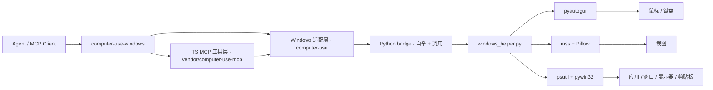

# Windows 电脑使用 Skill 0.8.0

## 安装方式

[下载 SKILL Zip 包](https://api.skillhub.cn/api/v1/download?slug=@indiv-twgh/computer-use-windows)，[SkillHub 页面](https://skillhub.cn/skills/indiv-twgh/computer-use-windows)

## 这个项目是什么

一个 Windows 桌面控制的 skill，同时是自带 MCP server 的独立 runtime：截图、鼠标、键盘、应用启动、窗口与显示器映射、剪贴板，共 25 个工具（逐个见「暴露的 MCP 工具」）。给 agent 的入口是 `SKILL.md`。

跟同类实现的差别在两处：

- **skill-first、客户端无关** —— 走 MCP over stdio，任何支持 MCP 的 agent 产品都能接，不绑定某个客户端的本机资产：没有私有 `.node` 二进制，不需要提取内部隐藏资源，只用公开依赖（`Node.js + Python + pyautogui + mss + Pillow + psutil + pywin32`）。
- **自带可自举的 runtime** —— 首次调用工具时自动创建 venv 并装依赖；vendored 的 TypeScript 工具层（门控、坐标换算、批量执行）已接到 Windows 原生的 Python backend。

装上 skill 之后**仍需一次性接通 MCP**：分发包自带 `project/dist/cli.js`（把 MCP SDK 全部内联的单文件 bundle），不需要 `npm install` / `npm run build`，`node_modules` 也不是安装前置；但客户端不会自动发现这个 server，必须把 MCP 配置指向它，工具才会出现在 agent 的工具列表里。有终端或文件写入权限的 agent 可以按 `SKILL.md`「前置检查」自助写入配置，用户只需确认一次；写入后是否还要手动重载取决于客户端——热更新客户端（如 Qoder Desktop）会在下一条用户消息开启的回合自动同步会话工具目录；启动快照客户端则需要在 MCP 页面把该 server 关掉再打开（或点「重新连接」）来新建进程；找不到 MCP 页面入口时，重启客户端效果相同。配置片段见 `references/mcp-config.json`。分发包是运行时副本，`project/` 下只有 `package.json`、`dist/cli.js` 与 `runtime/` 两个 Python 文件，不含 TypeScript 源码、`tsconfig.json` 和 `package-lock.json`。要改代码请在仓库源码树里 `cd project && npm install && npm run build`；发版前必须重建，否则 `package_skill.py` 会拒绝出包。

## 来源与许可

本项目由 [wimi321/windows-computer-use-skill](https://github.com/wimi321/windows-computer-use-skill)（MIT License，`Copyright (c) 2026 haoc`）重构而来，沿用它"skill + 独立 runtime + MCP server"的整体设计。MIT 要求保留上游版权声明，已一并写进 `LICENSE`；本项目同样以 MIT 发布。

重构集中在 Windows 侧：把 macOS 优先的工具层接到 Win32 原生 backend，加上混合 DPI 与多显示器、注册表安装项 ∪ 可见窗口合成的应用候选清单、分层授权与落点门控、会话锁，以及测试流水线。

## MCP 配置

> 首次接入由 agent 按 `SKILL.md`「前置检查：MCP 是否接通」自助完成；下面这段只是可直接粘贴的配置片段与字段说明。

```json
{
  "mcpServers": {
    "computer-use-windows": {
      "command": "node",
      "args": [
        "C:/Users/<user>/.agents/skills/computer-use-windows/project/dist/cli.js"
      ],
      "env": {
        "COMPUTER_USE_DEBUG": "0",
        "COMPUTER_USE_COORDINATE_MODE": "pixels"
      }
    }
  }
}
```

## 暴露的 MCP 工具

共 25 个（`teach_*` 系列在当前 CLI host 下不注册）：

| 分类 | 工具 |
| --- | --- |
| 会话与权限 | `request_access`、`list_granted_applications`、`release_lock` |
| 截图 | `screenshot`、`zoom` |
| 鼠标 | `left_click`、`double_click`、`triple_click`、`right_click`、`middle_click`、`left_click_drag`、`mouse_move`、`scroll`、`left_mouse_down`、`left_mouse_up`、`cursor_position` |
| 键盘 | `type`、`key`、`hold_key` |
| 应用与窗口 | `open_application`、`switch_display`、`wait` |
| 剪贴板 | `read_clipboard`、`write_clipboard` |
| 批处理 | `computer_batch` |

完整参数说明见 `references/tools.md`。

## Windows 实机验证结果

以下已在真实 Windows 机器上端到端验证通过：

- TypeScript 构建（`npm run build`）与类型检查（`npm run check`）
- Python venv 自举链路（首次运行自动创建 `.runtime/venv` 并安装依赖）
- Python helper 只读能力实测：权限检查、显示器枚举（2560x1600 x3）、截图采集（内容正确）、前台应用识别、光标位置、应用枚举
- MCP stdio 握手、`tools/list`、权限门控（未授权时截图被正确拒绝并提示先调 `request_access`）
- 实操链路：窗口激活、`left_click` 点击落点（150% DPI 缩放下坐标换算正确）、键盘组合键、Unicode 文本输入（空格/中文/全角标点完整）
- UAC / 管理员窗口：提权窗口可正确识别、截图与窗口管理正常；非提权 runtime 注入的输入被 Windows UIPI 拦截，helper 会显式报错并提示以管理员运行 runtime
- 混合 DPI 场景，多屏不同缩放验证通过

## 测试与发布前检查

一个入口跑完全部检查，任一步失败即退出码非零，可直接挂到发布前：

```bash
python scripts/run_tests.py            # 全部 8 个阶段，约 7 秒
python scripts/run_tests.py --quick    # 跳过 stdio 集成测试（不碰桌面锁）
python scripts/run_tests.py --list     # 列出阶段与实际命令
cd project && npm test                 # 等价入口
```

CI 跑的就是同一个入口：`.github/workflows/test.yml`，`windows-latest` 单 job，push 到 `master` / PR / 手动触发。它显式建 `project/.runtime/venv`（本地是 server 首次调用时自举，而单测直接 import helper，没有任何东西会触发那个自举），并且刻意不缓存 —— 恢复出来的 venv 若指向另一台 runner 的绝对路径，失败起来看着像代码回归。无桌面 runner 上监视器可能为空，stdio 阶段的断言只查不变式（未知显示器名不会静默成功、歧义名不会静默挑一个），环境相关的细节断言在装不齐样本机器上自动跳过，纯逻辑由单测覆盖。

| 阶段 | 覆盖 |
| --- | --- |
| build / typecheck | `tsc` 编译与类型检查 |
| skill structure | `validate_skill.py` —— SKILL.md 结构与引用完整性 |
| version sites | 七处版本号一致且格式为 `x.y.0`（五处声明 + `package-lock.json` 两处，`set_version.py --check`） |
| package allowlist | 打包顶层白名单：只收 `SKILL.md` / `references/` / `project/`，拒收 `.github` 等开发期文件 |
| helper unit tests | Python helper 纯逻辑：滚轮量换算、注册表路径展开、抢焦点不抛异常、窗口聚焦三态、坐标网格绘制与开关透传 |
| TS layer unit tests | `resolveGrantedApp` 逐级解析、terminal / browser 分类、坐标帧校验、`scaleCoord` 与 `scaleFactor` 解耦 |
| MCP stdio integration | 真实起 server 走 `initialize`、`tools/list`、门控错误文本与每轮 `[COORD FRAME]` 提醒 |

写测试的三条规矩：

- **不注入输入、不动用户窗口**。需要鼠标的断言一律打桩 —— `scroll` 的测试替换 `win32api.mouse_event` 只捕获参数、把 `move_pointer` 置空，所以随时能在正在干活的机器上跑。
- stdio 阶段会短暂获取桌面会话锁；若被其他 agent 会话占用，相关测试**跳过而不是失败**。
- 测试只放 `scripts/tests/`，任何临时产物写 `%TEMP%`（skill 目录内禁止落盘）。

每条断言都对应一个真实发生过的 bug —— 滚轮的 120 倍、未展开的 `%systemroot%`、`isdigit()` 处理不了负数图标索引、含空格路径被截成 `C:\Program`、松匹配的反向包含。加修复时顺手想清楚"哪条断言本来能拦住它"。

## 打包分发

```bash
python scripts/run_tests.py            # 先跑完整检查
cd scripts
python package_skill.py                # 生成 computer-use-windows.zip
```

打包的是纯净的 skill 目录结构：顶层**只允许** `SKILL.md`、`references/`、`project/` 三项（白名单），`.github/`、CI 配置、`AGENTS.md`、`ARCHITECTURE.md`、`README.md`、`scripts/`、构建产物与本地运行时数据一律不进包。`scripts/tests/test_package_skill.py` 在发布前门禁里守着这条规则。

## 项目结构

```text
AGENTS.md              # 开发期硬规则（agent 改仓库前读；不随 zip 分发）
ARCHITECTURE.md        # 源码分层、调用链、不可破的不变式（维护者向；不随 zip 分发）
SKILL.md               # 技能入口指引（使用 skill 的 agent 先读这个）
README.md              # 本文件
references/
  tools.md             # 25 个 MCP 工具的完整参数与错误码
  runtime.md           # 环境变量、helper 子命令、自举机制、数据落点
  troubleshooting.md   # 常见故障定位与处置
project/
  src/
    cli.ts             # 进程入口
    runtime.ts         # 传输无关门面（非 MCP 入口在此）
    server.ts          # MCP 接线
    session.ts         # 会话状态与锁回调
    computer-use/      # Windows 适配层（executor / gates / pythonBridge / imageSave / 锁）
    vendor/computer-use-mcp/  # 平台无关的 MCP 工具与门控框架
  runtime/             # Windows Python helper 与依赖清单
  dist/                # 构建产物（不随 zip 分发）
  .runtime/            # 自举 venv 与依赖 stamp（不随 zip 分发）
scripts/
  package_skill.py     # 打包分发脚本
  validate_skill.py    # skill 结构校验（UTF-8 安全，无第三方依赖）
```

## 架构



分层、调用链与不可破的不变式见 `ARCHITECTURE.md`。

## 运行说明

### 环境变量

| 变量 | 取值 | 默认 | 作用 |
| --- | --- | --- | --- |
| `COMPUTER_USE_ENABLED` | `0` 禁用 | 启用 | 全局开关；禁用时工具列表为空 |
| `COMPUTER_USE_COORDINATE_MODE` | `pixels` \| `normalized_0_100` | `pixels` | 坐标语义 |
| `COMPUTER_USE_DEBUG` | `1` 开启 | 关闭 | 调试日志输出到 stderr |
| `COMPUTER_USE_LOCK_IDLE_SECS` | 非负整数 | `300` | 会话锁空闲接管阈值（秒）；持有者闲置超过该时长后其他会话可接管，`0` 禁用接管 |

前两项在进程启动时读取一次，改动后需重启 server —— 在 MCP 页面关掉再打开该 server（或点「重新连接」），找不到入口就重启客户端，两者都会新建进程。完整变量表（含子开关）见 `references/runtime.md`。

### 权限

Windows 不像 macOS 那样需要 Accessibility / Screen Recording 授权弹窗，但仍可能受这些因素限制：

- agent 进程不是管理员，而目标窗口是管理员权限（UIPI 会拦截输入注入，helper 会显式报错）
- UAC 安全桌面切换
- 会话 / 远程桌面边界
- 应用自身的反自动化限制

此外，桌面同一时刻只允许一个 computer-use 会话操作，锁文件位于 `~/.computer-use-windows/computer-use.lock`。锁的释放有三条路：持有进程退出后自动回收；agent 任务结束时主动调 `release_lock`；持有者进程还活着但持续闲置（心跳超过 `COMPUTER_USE_LOCK_IDLE_SECS`，默认 300 秒）时被其他会话接管 —— 两个 IDE 常驻、其中一个不再使用 desktop 的场景不会再永久占锁。生命周期细节见 `references/runtime.md`「会话锁」。

### 会话模型

所有输入类工具都受会话白名单约束：必须先 `request_access` 授权应用，工具才会执行；未被授权的应用返回错误且不做任何操作。白名单还带授权档位（browser/trading → `read`，terminal/IDE → `click`，其余 → `full`）与可选 flag（`clipboardRead`、`clipboardWrite`、`systemKeyCombos`）。自带 CLI host 使用自动批准实现，无人工弹窗。

### 截图过滤

当前 runtime 声明的是 `screenshotFiltering: none`。

也就是说，截图过滤不是 compositor 原生级别，屏幕上所有窗口都会出现在截图里，动作 gating 仍由 MCP 层处理。与 macOS 实现不同，Windows 的动作前准备**不会隐藏**白名单外的窗口，只会把已授权应用置前。

### 平台范围

当前项目明确是 `Windows-only`。

覆盖能力：

- 截图（含区域放大、多显示器、混合 DPI）
- 鼠标控制（点击 / 拖拽 / 滚动 / 按下释放）
- 键盘输入（Unicode 文本、组合键、长按）
- 前台应用识别
- 已安装 / 运行中应用发现
- 窗口到显示器映射
- 剪贴板访问
- 应用启动

### 已知限制

- `request_access` 的候选应用清单是「注册表安装项 ∪ 当前有可见窗口的进程」，上限 50 个（超出会附 `... and N more`）。少数条目仍是不易读的文件名（如 `mspaint`、`store`、`devenv`），因为对应可执行文件没有版本资源可读。
- `resolvePrepareCapture` 的 `focusBeforeAction` 选项沿用 macOS 实现，helper 忽略它；`autoResolve` 已实现（按已授权应用窗口所在屏选显示器）。
- `check_permissions` 在 Windows 上恒返回已授权，因此 `tcc_not_granted` 分支不会触发。
- 控制台窗口归 `WindowsTerminal.exe` / `conhost.exe`，不是 shell 进程；宿主的父进程是 `svchost`、shell 不在其子树里，没有可靠的窗口→shell 映射可穿透（猜错就是把输入送进另一个可能已提权的 shell）。因此授权 shell 不能操作终端窗口，门控会给出专门说明；`open_application` 退化为聚焦宿主窗口，多 tab 时可见的那个未必是目标。
- 截图分辨率由消费方模型的输入预算决定（长边 1568px，且 `ceil(w/28)×ceil(h/28) ≤ 1568`）。2560x1600 的屏实际得到 1389x868，因此小字号文本要配合 `zoom` 阅读。可用 `COMPUTER_USE_IMAGE_MAX_PX` / `COMPUTER_USE_IMAGE_MAX_TOKENS` 调整，但请先读 [0.4.0：图像预算可配置](#0.4.0：图像预算可配置) 一节的前提说明。**这些数字是运行者侧实现细节，不是给模型的换算依据**：模型只把截图图像上读到的像素原样传回，server 完成映射，每个工具结果都会用 `[COORD FRAME]` 提醒这一点。截图默认保持干净（适合 UI 开发 / 视觉审查）；需要精确定位时可设 `COMPUTER_USE_COORD_GRID=1` 叠加淡坐标网格，标签数字就是该传的图像像素坐标。

## 更新日志

### 0.8.0：分发文档瘦身，SKILL.md 标题随版本同步，CI 打包冒烟

- **分发文档瘦身**：`references/runtime.md` 的「Windows 适配要点」移入仓库 `ARCHITECTURE.md`（维护者内容不再随包分发）；`SKILL.md` 删除能力自述、使用场景、仓库构建说明与重复的 MCP 配置片段（配置以 `references/mcp-config.json` 为准）；`references/troubleshooting.md` 移除仅仓库可用的构建 / 校验 / 打包条目。装到用户机器上的文档只剩运行时与排障真正需要的内容。
- **SKILL.md 标题带上版本号**（与 README 标题同一约定），`set_version.py` 从六处扩到七处一次同步。
- **CI 增加打包冒烟步骤**：每次 push 在干净 runner 上实际产出一次 zip，打包问题在推送时暴露而非发版时。

### 0.7.0：预编译入口随包分发，runtime 分层重构，会话锁身份改用 AGENT_SESSION_ID

- **入口 bundle 随包分发。** 分发 zip 内置 `project/dist/cli.js`（内联 MCP SDK 的自包含 esbuild 产物），自动升级只覆盖包内文件也能换到新代码，修复「升级后仍跑旧编译产物」的问题；同步补齐各客户端 MCP 接入说明。
- **抽出传输无关 runtime，MCP 层降为薄传输层**；`zoom` 修复非主屏漏加显示器 origin。
- **会话锁身份改用 `AGENT_SESSION_ID`**（原为特定客户端命名），缺失时仍退化为 `pid-<pid>`。
- **打包脚本改用顶层白名单**，`.github/` 等开发期文件不再进 zip；文档拆出 `ARCHITECTURE.md`，新增 Workbuddy 客户端接入 MCP 的重启与启用步骤。

### 0.6.0：版本号改为 x.y.0，硬规则写进 AGENTS.md

从这一版起版本号只数前两位：`x.y.0`，第三位固定为 0、不参与计数；前两位按十进制进一（`0.5.5 → 0.6.0 → … → 0.9.0 → 1.0.0`）。此前 0.5.1–0.5.5 每批改动都升 patch，看着像语义化版本其实并不是，现在把规则说死并让工具兜住。

- **规则由脚本强制执行。** `set_version.py` 的 `VERSION_RE` 收紧为 `^\d+\.\d+\.0$`，`--check` 也校验格式：写 `0.6.1` 直接拒绝并退出 1，不再只靠人记。六处版本声明仍由脚本一次同步。
- **新增 `AGENTS.md`。** 把版本与发版流程、坐标不可二次换算 / 每轮 `[COORD FRAME]` / 帧校验、环境变量生效边界、测试与临时文件、提交约定写成硬规则清单，供后续 agent 直接读。`package_skill.py` 已把它排除出分发 zip —— 开发期规则不进入安装的 skill。
- **修正环境变量生效边界的措辞。** 上一版文档里「每次读取 = 无需重启」是错的：`process.env` 是进程启动时从 MCP 配置继承的副本，改配置一律要重启 server。同步修正 `SKILL.md`、`references/runtime.md`、`references/troubleshooting.md` 与两处源码注释。

实测：`set_version.py 0.6.1` 返回 `not a version ... expected x.y.0` 且退出码 1；`set_version.py 0.6.0` 六处同步，`--check` 输出 `consistent: 0.6.0`；`npm test` 7 阶段全绿；打包文件清单不含 `AGENTS.md`。

### 0.5.5：把坐标规则从「要记住」改成「每次都看见、算错就拒绝」

长会话里最顽固的一类偏移，是模型把截图像素又乘了一遍系数：乘到物理像素是一个值、乘到逻辑点是另一个值，两者相差正好等于显示器 DPI 缩放，于是每次调用按当时「相信」的那个换算，落点来回漂。服务端 `scaleCoord` 本来就按 `displayWidth / screenshot.width` 换算过一次 —— 这是纯粹的二次换算。诱因不在算法，而在规则只出现在会话开头：`SKILL.md` 与工具描述读一次就沉底，单屏稳态下 `screenshot` 返回**零条文本**，反倒是多屏 label 里的 `WxH @150%` 和文档里的尺寸示例一直留在上下文，随时能被「重新推导」成公式；冷启动没有截图时的 `/scaleFactor` 猜测还会给出「自己算也能点动」的假反馈。本条日志刻意不写出那两个系数，理由相同。

- **每轮复述。** 新增 `coordinateFrame.ts` 作为唯一文案源；MCP 统一出口给**每个工具返回**（含错误）追加独立的 `[COORD FRAME]` 文本块。用独立块而不是拼接，是为了不破坏单行 JSON 结果的解析、不改变 `content[0]`（`computer_batch` 的 `firstTextContent` 依赖它），批内子动作也不会重复。
- **算错就拒绝。** `dispatchAction` 是所有独立动作与批内子动作的共用入口，在触碰鼠标前校验坐标帧：`pixels` 无截图锚点、坐标越过最近一张截图图像范围、百分比越界一律返回可自纠正的错误，并明确「图像边界不是换算系数」。旧的 `/scaleFactor` 冷启动退化删除。越界只拦得住落在图外的二次换算，落在图内的仍靠每轮提醒 —— 这条局限写进了文档和测试。
- **消除诱惑数字。** 工具参数描述、`computer_batch` 的 `coordinate`（原本完全没有坐标规则）、`initialize` 指令都按坐标模式生成并明确禁止换算；多屏提示与 `switch_display` 给 `WxH @scale%` 加上「只用于认屏幕」声明；`SKILL.md` 前置「零、坐标」唯一规则、删掉尺寸示例，实现细节数字集中到运行者参考并标注不得用于换算。
- **可选坐标网格（默认关闭）。** `windows_helper.py` 在缩放后、JPEG 编码前可叠淡网格与像素标签，标签数字就是该传的图像像素坐标，不改变图像尺寸；`zoom` 与 `normalized_0_100` 恒不画，绘制异常降级为干净截图。默认关闭是因为 UI 开发 / 视觉审查 / 截图存证需要原始像素，网格线会干扰对齐判断、也可能被误认成 UI 元素；`COMPUTER_USE_COORD_GRID=1` 按需开启。
- **版本门禁补齐。** `set_version.py` 从四处扩到六处，纳入 `package-lock.json` 的根版本与 `packages[""].version` —— 它还停在 0.4.2，而 `--check` 此前完全看不到。

实测：`python scripts/run_tests.py` 7 阶段全绿（新增 Python / TS / stdio 三层断言）；真机抓屏 1389x868 下网格开 / 关的 base64 不同且尺寸不变；`set_version.py --check` 输出 `consistent: 0.5.5`；`npm run build` 已同步 dist。

### 0.5.4：加了测试流水线，它当场抓出三个真 bug

之前这个仓库只有 `tsc --noEmit`，0.5.1–0.5.3 的所有验证都是实机手工跑的，一次性、不可重放。现在有了 `scripts/run_tests.py`：7 个阶段、40 条断言、约 6 秒，失败退出码非零，`npm test` 等价。三层 —— Python helper 纯逻辑（打桩捕获 `mouse_event` 参数，绝不动光标）、TS 层纯逻辑、以及真实起 server 走一遍 `initialize` / `tools/list` / 门控错误文本的 stdio 集成测试（被别的会话占着桌面锁时跳过而非失败）。

写测试的过程中当场抓到三个 bug，全部已修：

- **`_strip_icon_index` 处理不了负数图标索引。** 它用 `str.isdigit()` 判断逗号后的尾巴，而 `"-101".isdigit()` 是 False —— `app.exe,-101` 是 DisplayIcon 指向非首个图标的常规写法，后缀被留在路径上，产出又一个"看着像 bundleId、其实匹配不上任何进程"的条目，和 `%systemroot%` 是同一类故障。
- **含空格的未加引号路径被 `split()` 截断。** `C:\Program Files\My App, Inc\app.exe` 取第一个空格分词得到 `C:\Program` —— 比原样返回更糟，因为它看起来完全像个合法路径。改为按 `.exe` 结尾切：可执行文件路径以 `.exe` 结束而参数不会，顺带也正确处理了 `app.exe /silent`。
- **错误文本里"或者传 bundleId"是句假话。** `resolveGrantedApp` 的 bundleId 直通被 `looksLikeBundleId` 挡着 —— 那是个 macOS 反域名形状的正则（不含 `:` 和 `\`），Windows 的路径型 bundleId 一律过不了。现在先做无条件等值比对，那句建议才真的可用。

顺带把 `open_application` 的名字解析从 handler 里抽成导出的纯函数 `resolveGrantedApp`，否则它没法被测试 —— 而"多命中拒绝猜测"这条安全属性恰恰最需要断言兜住。

实测：`python scripts/run_tests.py` 7 阶段全绿；故意把 `WHEEL_DELTA` 改成 1 后流水线立刻 5 条断言失败并停在第 5 阶段，失败退出码 1、通过退出码 0 均已核对。

### 0.5.3：`open_application` 不再冒领成功，conhost 归入 terminal 档，版本号有了同步脚本

- **`open_application` 按真实结果说话。** helper 侧 `focus_existing_window` 改为三态（`focused` / `present` / `absent`），`open_app` 据此返回 `focused` / `present` / `launched`，工具层映射成四种文本：真正提到前台说 `Brought "X" to the front.`，新起进程说 `Opened "X".`，**应用在运行但 Windows 拒绝让后台进程抢焦点时说 `present` 并报错**，host 无法区分时给一句明确的中性文本。旧实现两种情况都回 `Opened`：一是模型据此在"应该在的位置"点击而那里其实是别的窗口，二是重试就多开一个窗口。vendor 的 `openApp` 签名相应变成 `Promise<OpenAppOutcome | void>`（本 skill 只在 Windows 上使用，所以动了共享层；返回 `void` 的 host 得到中性文本而非冒领）。
- **松匹配砍掉反向包含。** 0.5.2 引入显示名松匹配时写了双向 `includes`，结果 `Notepad++` 会同时命中一个普通的 `Notepad` 授权，把唯一答案变成假歧义 —— 是我自己加的"多命中拒绝猜测"保护把它暴露出来的。现在只保留「已授权显示名包含输入」与「输入等于可执行文件名」两个方向。
- **`conhost.exe` 归入 terminal 分类。** 它的显示名「Console Window Host」不含 "terminal" 子串，此前落到默认分类拿到 **full 档 = 完整键盘进 shell**。补了 `conhost` 与 `console window host` 两个精确子串，没加裸词 "console"。
- **`scripts/set_version.py`** —— `--show` / `--check` / `<版本>` 三种模式，一次同步 SKILL.md frontmatter、package.json、MCP serverInfo 字面量、README 标题四处。`--check` 在漂移时退出码 1，可以挂到发布前。版本号此前纯靠人工四处改，0.5.0 就漏过一处。

实测：`focused` 与 `launched` 两条文本实机观察到（`Brought "Notepad++ (64-bit x64)" to the front.` / `Opened "Notepad".`）；`open_application("Notepad++")` 在 `Notepad` 同时已授权的会话下唯一命中，反向包含修复确认；`getDeniedCategoryForApp` 对 conhost 与 Windows Terminal 均返回 `terminal`、对 Notepad++ 返回 `null`；`set_version.py` 三模式跑通，四处一致。`present` 分支也已实机观察到 —— 就是被 `alt+tab` 切走前台之后自然复现的：Windows 拒绝后台进程把 Notepad 提回来，工具按新行为报 `state_conflict` 并说明「不要再调用、先截图看真实前台」。四种结果里只剩 `void`（本 host 总能区分）未触发。`npm run build` / `check` / `validate_skill.py` 通过。

### 0.5.2：注册表路径展开、抢焦点不再抛异常、`open_application` 的名字与控制台窗口

0.5.1 发布后拿一个 XCGUI 自绘应用做回归，撞出一串既有缺陷，全部修掉。共同特征是「工具说成功、实际什么都没发生」或者反过来。

- **注册表路径先展开环境变量**（`expand_registry_path`）。PowerShell 的 App Paths 默认值是 `%systemroot%\system32\...`，而授权比对用的是进程镜像路径（永远是全展开的），于是这条 bundleId 匹配不上任何运行中的进程：应用显示为已授权却完全不可操作，`focus_existing_window` 找不到窗口，`prepare_for_action` 还会转而去聚焦别的应用。顺带 `file_description` 才第一次读得动，显示名从退化的 `PowerShell` 变成真实的「Windows PowerShell」。
- **`_force_foreground` 返回 bool 且不再抛异常**。原先只有第一次 `SetForegroundWindow` 有兜底，`AttachThreadInput` 之后的第二次没有 —— 而后台进程抢不到前台是常态，于是每个输入动作都可能把原始 pywin32 元组甩给模型：`Tool "left_click" failed: (0, 'SetForegroundWindow', ...)`。现在 `prepare_for_action` 忽略结果（紧随其后的前台门控会重读真实前台并报出正确的 `app_not_granted`），`focus_existing_window` 透传结果，让 `open_application` 能为「已置前」说真话。
- **`open_application` 的名字解析与 `request_access` 对齐**。旧实现要求显示名精确相等，而 `request_access` 是宽松解析的：授权 `Notepad++` 记成 `Notepad++ (64-bit x64)` 之后，`open_application("Notepad++")` 被拒，错误还说「call request_access first」，把模型推进重新授权的循环。现在是 bundleId → 精确 → 松匹配（显示名互为子串或等于可执行文件名）→ **多命中拒绝猜测**（`bad_args` 列出候选）→ 无命中列出已授权名字。
- **控制台应用**：窗口归 `WindowsTerminal.exe`，shell 不在其子树里（宿主父进程是 `svchost`），没有可靠的窗口→shell 映射，猜错就是把输入送进另一个可能已提权的 shell —— 所以不做 `resolve_window_pid` 那种穿透，改由 `consoleHostNote()` 在前台门控与落点校验处说清情况；同时 `open_application` 匹配不到窗口时改为聚焦宿主窗口，不再每次新开一个 tab。
- **`open_app` 的两条 `Popen` 兜底 `DEVNULL` 掉 stdio**。bridge 用 `execFile`，resolve 时机是所有 stdio 流 EOF 而非 helper 退出；被启动的程序继承 stdout 句柄会让工具一直挂到客户端超时（`-32603 did not complete`），而应用其实已经打开。`os.startfile` 不下传句柄，所以只有兜底分支会中招 —— 也正是第一条那个未展开路径逼出来的。

实测：`scroll` 四方向（down/up 幅度线性、left/right 借关闭自动换行的 Notepad++ 确认行首滚出与滑块位移）；`allowlist_empty`、两处 `app_not_granted`（含控制台宿主专门文案）、`tier_insufficient`、`cu_lock_held` 全部实机触发并核对文本；`open_application` 的精确 / 松匹配 / 歧义 / 无命中四条分支各自跑通；控制台应用连续两次 `open_application` 后进程与窗口数不变（修复前每次多一个）。`npm run build` / `check` 与 `validate_skill.py` 通过。

### 0.5.1：修好 `scroll` 的滚轮量，并让门控错误自己指路

**`scroll` 此前对自绘控件完全无效。** 症状是「工具返回 `Scrolled.`，页面纹丝不动」。根因不在 Windows 的滚轮投递方式，而在注入量：helper 走 `pyautogui.scroll()`，而它的 win32 实现把「格数」原样塞进 `mouse_event` 的 `dwData`，**从不乘 `WHEEL_DELTA(120)`** —— `scroll_amount: 3` 实际发出 delta=3，即 1/40 格。自绘控件（XCGUI / DirectUI）按 `delta / 120` 取整算行数，直接归零；浏览器会把小数 deltaY 累加掉，所以这条路径在浏览器里「看起来是好的」，一直掩盖着它。此外 pyautogui 的符号约定与 executor 的屏幕坐标 `dy` 相反（正数 = 向上滚），且它 `except (PermissionError, OSError): pass` 吞掉注入错误 —— 永远不会报错，只会静默无效。现在两个轴都自己乘 120、纵向按 `dy` 取负。

实测（XCGUI demo，同一落点，窗口区域像素差分 + 「只移光标不滚」对照组）：delta ±3 / ±30 → 0.00%；-120 → 15.83%；-360 → 14.75%。修复后 up / down 端到端复测通过。`PostMessage(WM_MOUSEWHEEL)` 同样能滚，但并不需要它 —— 硬件式注入本来就够，问题从来是量不够。

**门控错误与握手文案现在会把 agent 带到正确的下一步。** 不少客户端里的 agent 不加载 skill 就直接调 MCP 工具，第一个动作往往是 `screenshot`，必然失败；而原来的错误只说「不允许」，读起来像工具坏了。现在四层各就各位，分工记录在 `references/tools.md`「门控错误文案」：

- MCP `initialize` 新增 `instructions` —— 唯一前置到首次调用之前的文案位，写明 `request_access → screenshot → act` 的固定顺序。
- `ACCESS_GATE_GUIDANCE` 拼在 `allowlist_empty` 与两处 `app_not_granted` 尾部：给出可直接照做的 `request_access` 形状，并点名一个高频成因 —— 授权记的是 exe 路径，应用重新构建换目录（`go run` 每次换 `go-build<hash>` 临时目录）、重装、便携应用被移动之后，已授权应用会重新变成「不在白名单」。
- `TIER_ANTI_SUBVERSION` 改为跨平台措辞，并补上原先只点名 macOS 工具时留着的那扇门：直接命令行调用 `windows_helper.py` 的子命令可以绕开全部门控。
- `cu_lock_held` 的三个出口统一拼上 `LOCK_HELD_GUIDANCE`，澄清 `release_lock` 只能释放本会话的锁；空闲接管的具体秒数改由 host 按 `COMPUTER_USE_LOCK_IDLE_SECS` 实际值生成，`=0` 时不再给出根本不存在的接管承诺。

顺带：落点校验的文案不再写死 `Click at these coordinates`（`scroll` 与拖拽同样走这条路径）；`SKILL.md` frontmatter 的版本号从 0.4.2 补齐（0.5.0 发布时漏了这一处）。

实测：`npm run build` 与 `npm run check` 通过；`instructions` 经真实 stdio 握手确认已下发；两条 `cu_lock_held` 组合文案（默认 300 秒 / `COMPUTER_USE_LOCK_IDLE_SECS=0`）走代码路径渲染核对，确认 host 与 vendor 两半不重复、不矛盾。

### 0.5.0：会话锁可释放了（心跳空闲接管 + `release_lock`）

v0.4.x 的锁一旦获取就持有到 server 进程退出：两个 IDE 同时开着，先做过一次 desktop 操作的那个会永久占锁，另一个永远拿到 `cu_lock_held` —— 即使它早就不再使用桌面。本次两项改进，互补：

- **心跳 + 空闲接管**：锁文件新增 `lastHeartbeat` 字段，本会话每次经过锁门控都刷新（`touchComputerUseLock`）。持有者进程还活着但心跳超过 `COMPUTER_USE_LOCK_IDLE_SECS`（默认 300 秒，`0` 禁用）时，其他会话的 check/acquire 将其视为 stale 回收并接管。活跃会话的每次工具调用都在刷新心跳，不会中途被抢 —— 粘住的只是真正闲置的会话。
- **`release_lock` 工具**（第 25 个工具）：agent 任务结束时主动放锁，不等空闲兜底。幂等：未持锁时返回「nothing to release」而非错误；锁被其他会话持有时照常在门控处报 `cu_lock_held`。释放后需要桌面时直接调动作工具即可自动重新获取。

兼容性：pre-0.5.0 的锁文件没有心跳字段，视为「无闲置证据」，不会被接管（避免抢活蹦乱跳的旧版本会话），进程退出回收照旧。锁的获取时机不变（首个动作工具，`request_access` 等仍是 defer）。

实测：锁语义 11 项断言（获取 / 自见 / 阻塞 / 空闲接管 / 被抢后原持有者阻塞 / 释放 / 幂等 / 旧锁不接管）+ MCP stdio 全链路 11 项（25 工具注册、截图持锁、release 删文件、幂等、再获取）全部通过。

### 0.4.2：权限检查不再每次工具调用都问一遍

vendored 框架的 Gate 2 会在**每次工具调用**前查询 OS 权限。macOS 上这是真的 TCC 检查；Windows 上没有 TCC 可问，helper 返回常量 `{accessibility: true, screenRecording: true}` —— 但这一次"询问"是一个完整的 Python 进程：

```
check_permissions 实测 5 次: 246 / 221 / 220 / 238 / 221 ms   → 均值 229ms
一次 wait 工具调用: 294ms  ← 几乎全部花在这个检查上
```

于是把它**记忆化为每进程一次**，每次工具调用省下约 230ms（约 20% 延迟；`left_click` 实测 1475ms → 1240ms）。失败不缓存，瞬时进程错误不会把会话永久钉在"权限缺失"状态。

同时清理了这个不可达分支上的谎话：报错原文是 `"Windows Accessibility and Screen Recording are now both granted."` —— macOS 词汇前直接拼了平台名，而 Windows 上既没有这两个权限，也没有那个面板。现在改为平台中立措辞（`input control` / `screen capture`），并在 Gate 2、`tcc_not_granted`、`tccState` 三处标注"Windows 上不可达"。

分支**没有删除**，因为它是"平台前置条件"的正确接缝 —— Windows 上真实存在的是另一组问题：**会话 0 / 无交互桌面、RDP 断开、UAC 安全桌面**。代码里写明了：若把这些接进来，必须同时移除记忆化（那些状态会在运行期间变化）。
### 0.4.1：缓动默认关闭、补文档

- **`COMPUTER_USE_MOUSE_ANIMATION` 改为默认关闭**（显式 `=1` 才开启）。缓动对普通点击没有价值，只对少数需要"真实指针轨迹"的软件有用（悬停才展开的菜单、监听移动的拖放目标），代价是每次点击最多多等约 0.5 秒。
- 文档新增**落点校验（hit-test）**一节：所有鼠标落点类工具在注入输入前会检查目标坐标下的应用，不在白名单或档位不足都会拒绝执行。
- 修掉架构图在 Typora 里的 `Lexical error`：mermaid 10.1.0 的词法分析器不接受**未加引号的 `·`**，节点标签一律加引号即可（`/`、`-`、`+`、中文各自都没问题，是 `·` 触发的）。

### 0.4.0：图像预算可配置

先解释清楚它到底是什么：

视觉模型不把整张图当一个输入，而是切成 **28×28 像素的 tile**，每个 tile 花 1 个 token。所以一张图的代价是 `ceil(w/28) × ceil(h/28)`。本 runtime 用两个上限（长边 1568px、总 tile 数 1568）预先缩放截图，于是每张截图的代价被钉在约 1550 tokens，与显示器多大无关。2560x1600 的屏按原尺寸送是 5336 tokens（3.4 倍），缩到 1389x868 后才达标。

**为什么必须本地先缩**：这两个数不是本 runtime 的偏好，而是移植自消费方模型自己的图像转码器。预先缩到"消费方不会再动"的尺寸，才能保证 `ScreenshotResult.width/height` 等于模型真正看到的图 —— `scaleCoord` 靠这个比例换算点击坐标。如果本地按 1389 算、而消费方又缩到别的尺寸，点击就会按错误比例偏移（1568 与 1389 之差约 13%）。

**新增开关**：

| 变量 | 取值 | 默认 |
| --- | --- | --- |
| `COMPUTER_USE_IMAGE_MAX_PX` | 正整数，或 `native` | 1568 |
| `COMPUTER_USE_IMAGE_MAX_TOKENS` | 正整数，或 `native` | 1568 |

`native` 表示不做预处理、直接发原始截图。**仅在消费方模型确实接受更大的图时才有意义**（本地 VLM，或 tiling 参数不同的服务）；否则图会在到达时被重新缩放，模型按更大的图读数取坐标，而我们报告的尺寸更小，点击反而更不准 —— 覆盖默认值时启动会打印一条 warn 提示这点。调高预算建议同时用 `COMPUTER_USE_COORDINATE_MODE=normalized_0_100`：百分比坐标的换算不依赖图像像素尺寸，不受下游重缩影响。

想"看清细节"请优先用 `zoom`：它把区域裁出来再放大，预算作用在那一小块上，同一屏幕面积的有效像素远高于整屏截图。

### 0.3.1：不再放大截图

截图目标尺寸此前会乘显示器缩放系数 —— 又是 macOS 移植残留（那边 `DisplayGeometry` 是逻辑点，需要乘才能得到物理像素）。本后端上报的已是物理像素，乘上去只会把图放大：1280x800 的屏会被插值成 1389x868，像素更多、载荷更大、细节为零。分辨率足够大的屏受 token 预算限制，乘与不乘结果相同，因此这个偏差一直没暴露。`zoom` 的放大属刻意行为，保留（改用独立的 `zoomTargetDims`）。

### 0.3.0：补齐应用枚举

`request_access` 的候选清单此前只来自注册表，导致模型看不到 Store 应用（计算器就在屏上却拿不到名字），同时混入大量内部代号（`olk`、`msoasb`、`IEDIAGCMD`）。两项改动：

- **显示名改取可执行文件的版本资源**（仅 `App Paths` 分支）：`olk` → `Microsoft Outlook`、`chrome` → `Google Chrome`、`EXCEL` → `Microsoft Excel`。Uninstall 分支不动 —— 它的 `DisplayName` 已是本地化的用户可见名称（`剪映专业版`、`阿里云盘`），用版本资源覆盖反而更差（→ `JianyingPro`、`aDrive`）。
- **并入「当前有可见窗口的进程」**（新增 helper 命令 `list_window_apps`）：可见窗口是「这是用户能指认的应用」的最强信号，Store 应用由此进入清单。窗口来源的条目跳过安装路径白名单，否则 `D:\apps\`、`C:\apps\` 下的便携应用会被丢掉。

实测：清单中出现 `Calculator`；抽样的 `Calculator`、`Notepad`、`Google Chrome`、`MuMu模拟器` 四个名称全部授权成功（中文名亦正常）。

### 0.2.1：实机验证中修掉的缺陷

以下五项都是在一台 3 屏 2560x1600 @150% 的真机上跑 MCP 全链路时暴露并修复的：

| 缺陷 | 现象 | 修复 |
| --- | --- | --- |
| helper 输出编码 | 显示器标签的 `·`、中文应用名、剪贴板内容变成 U+FFFD（Python 按 cp936 写管道） | 调用侧 `PYTHONIOENCODING=utf-8` + helper 自行 `reconfigure` |
| 剪贴板崩溃 | `read_clipboard` 报 access violation（x64 HANDLE 被截断成 32 位） | 为剪贴板 / 句柄 API 声明 `argtypes` / `restype` |
| Store 应用无法驱动 | 计算器能授权却打不开、点不到（窗口归 `ApplicationFrameHost.exe`） | 新增 `resolve_window_pid`，穿透 `ApplicationFrameWindow` 找到宿主进程 |
| 自动定位显示器空转 | 已授权应用在第 2/3 屏，首张截图却总在主屏 | helper 的 `resolve_prepare_capture` 支持 `autoResolve` + `allowlistBundleIds` |
| `type` 极慢 | 27 字符耗时 7.1 秒（每个字素启动一次 Python 进程） | 连续普通字符合并为一次调用，同字符串降到 1.1 秒 |
| `open_application` 重复开窗 | 契约是「带到前台」，实际每次调用都新开一个窗口（验证期间攒出 3 个记事本窗口） | 先按宿主进程匹配已有窗口并聚焦，找不到才启动 |

### 0.2.0：补齐 save_to_disk 与鼠标缓动，清理死代码

- `COMPUTER_USE_HIDE_BEFORE_ACTION` 更名为 `COMPUTER_USE_FOCUS_BEFORE_ACTION`（Windows 侧从不隐藏窗口）。
- 实现 `COMPUTER_USE_MOUSE_ANIMATION` 指针缓动：按距离计算 pyautogui 时长（2000 px/秒，上限 0.5 秒），每次动作前重新读取门控，中途改动即时生效。
- `save_to_disk: true` 现在真的写盘：输出到 `%TEMP%\computer-use-windows\` 并在结果里返回绝对路径。
- `list_granted_applications` 的返回值新增 `coordinateMode`，与工具描述一致。
- 删除了 `inputLoader.ts` / `swiftLoader.ts` / `escHotkey.ts` / `drainRunLoop.ts` 四个遗留占位模块（调用即抛错，本 runtime 从未使用）。

