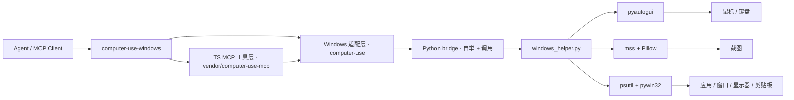

# Windows Computer-Use Skill 0.1.1

## 项目定位

这个项目完全本地化，同时是：

- 一个顶级 `skill`（入口见 `SKILL.md`）
- 一套独立的 Windows 桌面控制 runtime
- 一个给 agent 生态使用的 computer-use MCP server

它是 skill-first，客户端无关，可对接任意支持 MCP 的 agent 产品。

## 这个项目解决什么问题

- 不依赖任何特定 agent 客户端的本机应用
- 不依赖私有 `.node` 二进制
- 不依赖提取内部隐藏资产
- skill 装上、server 构建好，就能直接用

## 你现在拿到的能力

- 顶级 Windows computer-use skill
- 独立 MCP server：截图、鼠标、键盘、应用启动、窗口/显示器映射、剪贴板
- 只使用公开依赖：`Node.js + Python + pyautogui + mss + Pillow + psutil + pywin32`
- 首次运行自动自举：自动创建虚拟环境并安装 Python 依赖
- 提取出来的 TypeScript 工具层已经接到 Windows 原生 Python backend

## 暴露的 MCP 工具

共 24 个（`teach_*` 系列在当前 CLI host 下不注册）：

| 分类 | 工具 |
| --- | --- |
| 会话与权限 | `request_access`、`list_granted_applications` |
| 截图 | `screenshot`、`zoom` |
| 鼠标 | `left_click`、`double_click`、`triple_click`、`right_click`、`middle_click`、`left_click_drag`、`mouse_move`、`scroll`、`left_mouse_down`、`left_mouse_up`、`cursor_position` |
| 键盘 | `type`、`key`、`hold_key` |
| 应用与窗口 | `open_application`、`switch_display`、`wait` |
| 剪贴板 | `read_clipboard`、`write_clipboard` |
| 批处理 | `computer_batch` |

完整参数说明见 `references/tools.md`。

## Windows 实机验证结果

以下已在真实 Windows 机器上端到端验证通过：

- TypeScript 构建（`npm run build`）与类型检查（`npm run check`）
- Python venv 自举链路（首次运行自动创建 `.runtime/venv` 并安装依赖）
- Python helper 只读能力实测：权限检查、显示器枚举（2560x1600 x3）、截图采集（内容正确）、前台应用识别、光标位置、应用枚举
- MCP stdio 握手、`tools/list`、权限门控（未授权时截图被正确拒绝并提示先调 `request_access`）
- 实操链路：窗口激活、`left_click` 点击落点（150% DPI 缩放下坐标换算正确）、键盘组合键、Unicode 文本输入（空格/中文/全角标点完整）
- UAC / 管理员窗口：提权窗口可正确识别、截图与窗口管理正常；非提权 runtime 注入的输入被 Windows UIPI 拦截，helper 会显式报错并提示以管理员运行 runtime
- 混合 DPI 场景，多屏不同缩放验证通过

## 架构



分层细节见 `references/runtime.md`。

## 安装与构建

从 zip 分发的 skill 不含 `dist/`、`node_modules/`、`.runtime/`，必须自行构建：

```bash
cd project
npm install
npm run build
```

前置条件：Node.js >= 20；系统内可用 `py -3` 或 `python`。Python 依赖在首次实际调用工具时自举，构建期不安装。

## MCP 配置

```json
{
  "mcpServers": {
    "computer-use-windows": {
      "command": "node",
      "args": [
        "C:/Users/<user>/.agents/skills/computer-use-windows/project/dist/cli.js"
      ],
      "env": {
        "COMPUTER_USE_DEBUG": "0",
        "COMPUTER_USE_COORDINATE_MODE": "pixels"
      }
    }
  }
}
```

### 打包分发

```bash
cd scripts
python package_skill.py            # 生成 computer-use-windows.zip
```

打包会排除 `dist/`、`node_modules/`、`.runtime/`、`scripts/`、`README.md`、`LICENSE` —— 安装方需按上文自行构建。

## 运行说明

### 环境变量

| 变量 | 取值 | 默认 | 作用 |
| --- | --- | --- | --- |
| `COMPUTER_USE_ENABLED` | `0` 禁用 | 启用 | 全局开关；禁用时工具列表为空 |
| `COMPUTER_USE_COORDINATE_MODE` | `pixels` \| `normalized_0_100` | `pixels` | 坐标语义 |
| `COMPUTER_USE_DEBUG` | `1` 开启 | 关闭 | 调试日志输出到 stderr |

前两项在进程启动时读取一次，改动后需重启 server。完整变量表（含子开关）见 `references/runtime.md`。

### 权限

Windows 不像 macOS 那样需要 Accessibility / Screen Recording 授权弹窗，但仍可能受这些因素限制：

- agent 进程不是管理员，而目标窗口是管理员权限（UIPI 会拦截输入注入，helper 会显式报错）
- UAC 安全桌面切换
- 会话 / 远程桌面边界
- 应用自身的反自动化限制

此外，桌面同一时刻只允许一个 computer-use 会话操作，锁文件位于 `~/.computer-use-windows/computer-use.lock`。

### 会话模型

所有输入类工具都受会话白名单约束：必须先 `request_access` 授权应用，工具才会执行；未被授权的应用返回错误且不做任何操作。白名单还带授权档位（browser/trading → `read`，terminal/IDE → `click`，其余 → `full`）与可选 flag（`clipboardRead`、`clipboardWrite`、`systemKeyCombos`）。自带 CLI host 使用自动批准实现，无人工弹窗。

### 截图过滤

当前 runtime 声明的是 `screenshotFiltering: none`。

也就是说，截图过滤不是 compositor 原生级别，屏幕上所有窗口都会出现在截图里，动作 gating 仍由 MCP 层处理。与 macOS 实现不同，Windows 的动作前准备**不会隐藏**白名单外的窗口，只会把已授权应用置前。

### 平台范围

当前项目明确是 `Windows-only`。

覆盖能力：

- 截图（含区域放大、多显示器、混合 DPI）
- 鼠标控制（点击 / 拖拽 / 滚动 / 按下释放）
- 键盘输入（Unicode 文本、组合键、长按）
- 前台应用识别
- 已安装 / 运行中应用发现
- 窗口到显示器映射
- 剪贴板访问
- 应用启动

### 已知限制

- `screenshot` / `zoom` 的 `save_to_disk` 参数仅在 schema 中声明，当前实现不会写盘；截图通过 MCP image content 返回。
- `COMPUTER_USE_MOUSE_ANIMATION` 与 `COMPUTER_USE_HIDE_BEFORE_ACTION` 在当前 Windows 后端不产生实际效果。
- `check_permissions` 在 Windows 上恒返回已授权，因此 `tcc_not_granted` 分支不会触发。

## 项目结构

```text
SKILL.md               # 技能入口指引（agent 先读这个）
README.md              # 本文件
references/
  tools.md             # 24 个 MCP 工具的完整参数与错误码
  runtime.md           # 环境变量、helper 子命令、自举机制、分层说明
  troubleshooting.md   # 常见故障定位与处置
project/
  src/
    computer-use/      # Windows 适配层（executor / gates / pythonBridge / 锁）
    vendor/computer-use-mcp/  # 平台无关的 MCP 工具与门控框架
  runtime/             # Windows Python helper 与依赖清单
  dist/                # 构建产物（不随 zip 分发）
  .runtime/            # 自举 venv 与依赖 stamp（不随 zip 分发）
scripts/
  package_skill.py     # 打包分发脚本
```

## 路线图

- 实现 `save_to_disk` 截图落盘
- 改进 Windows 应用身份识别与图标提取
- 增加自动化 Windows 集成测试
- 提供更易分发的本地 release 产物
