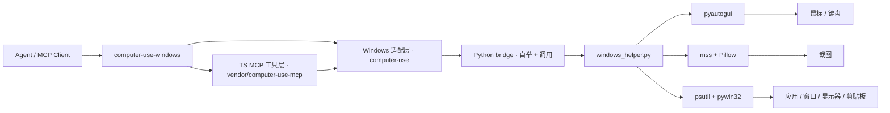

# Windows Computer-Use Skill 0.4.1

## 项目定位

这个项目完全本地化，同时是：

- 一个顶级 `skill`（入口见 `SKILL.md`）
- 一套独立的 Windows 桌面控制 runtime
- 一个给 agent 生态使用的 computer-use MCP server

它是 skill-first，客户端无关，可对接任意支持 MCP 的 agent 产品。

## 这个项目解决什么问题

- 不依赖任何特定 agent 客户端的本机应用
- 不依赖私有 `.node` 二进制
- 不依赖提取内部隐藏资产
- skill 装上、server 构建好，就能直接用

## 你现在拿到的能力

- 顶级 Windows computer-use skill
- 独立 MCP server：截图、鼠标、键盘、应用启动、窗口/显示器映射、剪贴板
- 只使用公开依赖：`Node.js + Python + pyautogui + mss + Pillow + psutil + pywin32`
- 首次运行自动自举：自动创建虚拟环境并安装 Python 依赖
- 提取出来的 TypeScript 工具层已经接到 Windows 原生 Python backend

## 暴露的 MCP 工具

共 24 个（`teach_*` 系列在当前 CLI host 下不注册）：

| 分类 | 工具 |
| --- | --- |
| 会话与权限 | `request_access`、`list_granted_applications` |
| 截图 | `screenshot`、`zoom` |
| 鼠标 | `left_click`、`double_click`、`triple_click`、`right_click`、`middle_click`、`left_click_drag`、`mouse_move`、`scroll`、`left_mouse_down`、`left_mouse_up`、`cursor_position` |
| 键盘 | `type`、`key`、`hold_key` |
| 应用与窗口 | `open_application`、`switch_display`、`wait` |
| 剪贴板 | `read_clipboard`、`write_clipboard` |
| 批处理 | `computer_batch` |

完整参数说明见 `references/tools.md`。

## Windows 实机验证结果

以下已在真实 Windows 机器上端到端验证通过：

- TypeScript 构建（`npm run build`）与类型检查（`npm run check`）
- Python venv 自举链路（首次运行自动创建 `.runtime/venv` 并安装依赖）
- Python helper 只读能力实测：权限检查、显示器枚举（2560x1600 x3）、截图采集（内容正确）、前台应用识别、光标位置、应用枚举
- MCP stdio 握手、`tools/list`、权限门控（未授权时截图被正确拒绝并提示先调 `request_access`）
- 实操链路：窗口激活、`left_click` 点击落点（150% DPI 缩放下坐标换算正确）、键盘组合键、Unicode 文本输入（空格/中文/全角标点完整）
- UAC / 管理员窗口：提权窗口可正确识别、截图与窗口管理正常；非提权 runtime 注入的输入被 Windows UIPI 拦截，helper 会显式报错并提示以管理员运行 runtime
- 混合 DPI 场景，多屏不同缩放验证通过

## 架构



节点标签一律加引号。原因不是美观：mermaid 10.1.0（Typora 内置版本）的词法分析器遇到**未加引号的 `·`（U+00B7 间隔号）**会直接报 `Lexical error ... Unrecognized text.`，而 `/`、`-`、`+`、中文单独都没问题 —— 加引号后 10.1.0 与 12.x 都能渲染。

分层细节见 `references/runtime.md`。

## 安装与构建

从 zip 分发的 skill 不含 `dist/`、`node_modules/`、`.runtime/`，必须自行构建：

```bash
cd project
npm install
npm run build
```

前置条件：Node.js >= 20；系统内可用 `py -3` 或 `python`。Python 依赖在首次实际调用工具时自举，构建期不安装。

## MCP 配置

```json
{
  "mcpServers": {
    "computer-use-windows": {
      "command": "node",
      "args": [
        "C:/Users/<user>/.agents/skills/computer-use-windows/project/dist/cli.js"
      ],
      "env": {
        "COMPUTER_USE_DEBUG": "0",
        "COMPUTER_USE_COORDINATE_MODE": "pixels"
      }
    }
  }
}
```

### 打包分发

```bash
python scripts/validate_skill.py .   # 先校验 skill 结构
cd scripts
python package_skill.py              # 生成 computer-use-windows.zip
```

打包会排除 `dist/`、`node_modules/`、`.runtime/`、`scripts/`、`README.md`、`LICENSE` —— 安装方需按上文自行构建。

`validate_skill.py` 与本仓库外的通用校验器不同之处在于它显式按 UTF-8 读取，因此在中文 Windows（默认 GBK）上不会因非 ASCII 的 `description` 崩溃。

## 运行说明

### 环境变量

| 变量 | 取值 | 默认 | 作用 |
| --- | --- | --- | --- |
| `COMPUTER_USE_ENABLED` | `0` 禁用 | 启用 | 全局开关；禁用时工具列表为空 |
| `COMPUTER_USE_COORDINATE_MODE` | `pixels` \| `normalized_0_100` | `pixels` | 坐标语义 |
| `COMPUTER_USE_DEBUG` | `1` 开启 | 关闭 | 调试日志输出到 stderr |

前两项在进程启动时读取一次，改动后需重启 server。完整变量表（含子开关）见 `references/runtime.md`。

### 权限

Windows 不像 macOS 那样需要 Accessibility / Screen Recording 授权弹窗，但仍可能受这些因素限制：

- agent 进程不是管理员，而目标窗口是管理员权限（UIPI 会拦截输入注入，helper 会显式报错）
- UAC 安全桌面切换
- 会话 / 远程桌面边界
- 应用自身的反自动化限制

此外，桌面同一时刻只允许一个 computer-use 会话操作，锁文件位于 `~/.computer-use-windows/computer-use.lock`。

### 会话模型

所有输入类工具都受会话白名单约束：必须先 `request_access` 授权应用，工具才会执行；未被授权的应用返回错误且不做任何操作。白名单还带授权档位（browser/trading → `read`，terminal/IDE → `click`，其余 → `full`）与可选 flag（`clipboardRead`、`clipboardWrite`、`systemKeyCombos`）。自带 CLI host 使用自动批准实现，无人工弹窗。

### 截图过滤

当前 runtime 声明的是 `screenshotFiltering: none`。

也就是说，截图过滤不是 compositor 原生级别，屏幕上所有窗口都会出现在截图里，动作 gating 仍由 MCP 层处理。与 macOS 实现不同，Windows 的动作前准备**不会隐藏**白名单外的窗口，只会把已授权应用置前。

### 平台范围

当前项目明确是 `Windows-only`。

覆盖能力：

- 截图（含区域放大、多显示器、混合 DPI）
- 鼠标控制（点击 / 拖拽 / 滚动 / 按下释放）
- 键盘输入（Unicode 文本、组合键、长按）
- 前台应用识别
- 已安装 / 运行中应用发现
- 窗口到显示器映射
- 剪贴板访问
- 应用启动

### 已知限制

- `request_access` 的候选应用清单是「注册表安装项 ∪ 当前有可见窗口的进程」，上限 50 个（超出会附 `... and N more`）。少数条目仍是不易读的文件名（如 `mspaint`、`store`、`devenv`），因为对应可执行文件没有版本资源可读。
- `resolvePrepareCapture` 的 `focusBeforeAction` 选项沿用 macOS 实现，helper 忽略它；`autoResolve` 已实现（按已授权应用窗口所在屏选显示器）。
- `check_permissions` 在 Windows 上恒返回已授权，因此 `tcc_not_granted` 分支不会触发。
- 鼠标缓动默认**关闭**（光标瞬移）。只有少数需要"真实指针轨迹"的软件才值得开：`COMPUTER_USE_MOUSE_ANIMATION=1` 会按距离计算时长（2000 px/秒，上限 0.5 秒），代价是每次点击 / 拖拽 / 移动最多多等约 0.5 秒。
- 截图分辨率由消费方模型的输入预算决定（长边 1568px，且 `ceil(w/28)×ceil(h/28) ≤ 1568`）。2560x1600 的屏实际得到 1389x868，因此小字号文本要配合 `zoom` 阅读。可用 `COMPUTER_USE_IMAGE_MAX_PX` / `COMPUTER_USE_IMAGE_MAX_TOKENS` 调整，但请先读 0.4.0 一节的前提说明。

### 与 0.1.x 的差异

- `COMPUTER_USE_HIDE_BEFORE_ACTION` 更名为 `COMPUTER_USE_FOCUS_BEFORE_ACTION`（Windows 侧从不隐藏窗口）。旧名不再保留 —— 技能尚未发布，不存在需要兼容的存量配置。
- `save_to_disk: true` 现在真的写盘：输出到 `%TEMP%\computer-use-windows\` 并在结果里返回绝对路径。
- `list_granted_applications` 的返回值新增 `coordinateMode`，与工具描述一致。
- 删除了 `inputLoader.ts` / `swiftLoader.ts` / `escHotkey.ts` / `drainRunLoop.ts` 四个遗留占位模块（调用即抛错，本 runtime 从未使用）。

### 0.2.1：实机验证中修掉的缺陷

以下五项都是在一台 3 屏 2560x1600 @150% 的真机上跑 MCP 全链路时暴露并修复的：

| 缺陷 | 现象 | 修复 |
| --- | --- | --- |
| helper 输出编码 | 显示器标签的 `·`、中文应用名、剪贴板内容变成 U+FFFD（Python 按 cp936 写管道） | 调用侧 `PYTHONIOENCODING=utf-8` + helper 自行 `reconfigure` |
| 剪贴板崩溃 | `read_clipboard` 报 access violation（x64 HANDLE 被截断成 32 位） | 为剪贴板 / 句柄 API 声明 `argtypes` / `restype` |
| Store 应用无法驱动 | 计算器能授权却打不开、点不到（窗口归 `ApplicationFrameHost.exe`） | 新增 `resolve_window_pid`，穿透 `ApplicationFrameWindow` 找到宿主进程 |
| 自动定位显示器空转 | 已授权应用在第 2/3 屏，首张截图却总在主屏 | helper 的 `resolve_prepare_capture` 支持 `autoResolve` + `allowlistBundleIds` |
| `type` 极慢 | 27 字符耗时 7.1 秒（每个字素启动一次 Python 进程） | 连续普通字符合并为一次调用，同字符串降到 1.1 秒 |
| `open_application` 重复开窗 | 契约是「带到前台」，实际每次调用都新开一个窗口（验证期间攒出 3 个记事本窗口） | 先按宿主进程匹配已有窗口并聚焦，找不到才启动 |

### 0.3.0：补齐应用枚举

`request_access` 的候选清单此前只来自注册表，导致模型看不到 Store 应用（计算器就在屏上却拿不到名字），同时混入大量内部代号（`olk`、`msoasb`、`IEDIAGCMD`）。两项改动：

- **显示名改取可执行文件的版本资源**（仅 `App Paths` 分支）：`olk` → `Microsoft Outlook`、`chrome` → `Google Chrome`、`EXCEL` → `Microsoft Excel`。Uninstall 分支不动 —— 它的 `DisplayName` 已是本地化的用户可见名称（`剪映专业版`、`阿里云盘`），用版本资源覆盖反而更差（→ `JianyingPro`、`aDrive`）。
- **并入「当前有可见窗口的进程」**（新增 helper 命令 `list_window_apps`）：可见窗口是「这是用户能指认的应用」的最强信号，Store 应用由此进入清单。窗口来源的条目跳过安装路径白名单，否则 `D:\appsd\`、`C:\apps\` 下的便携应用会被丢掉。

实测：清单中出现 `Calculator`；抽样的 `Calculator`、`Notepad`、`Google Chrome`、`MuMu模拟器` 四个名称全部授权成功（中文名亦正常）。

### 0.3.1：不再放大截图

截图目标尺寸此前会乘显示器缩放系数 —— 又是 macOS 移植残留（那边 `DisplayGeometry` 是逻辑点，需要乘才能得到物理像素）。本后端上报的已是物理像素，乘上去只会把图放大：1280x800 的屏会被插值成 1389x868，像素更多、载荷更大、细节为零。分辨率足够大的屏受 token 预算限制，乘与不乘结果相同，因此这个偏差一直没暴露。`zoom` 的放大属刻意行为，保留（改用独立的 `zoomTargetDims`）。

### 0.4.0：图像预算可配置

先解释清楚它到底是什么：

视觉模型不把整张图当一个输入，而是切成 **28×28 像素的 tile**，每个 tile 花 1 个 token。所以一张图的代价是 `ceil(w/28) × ceil(h/28)`。本 runtime 用两个上限（长边 1568px、总 tile 数 1568）预先缩放截图，于是每张截图的代价被钉在约 1550 tokens，与显示器多大无关。2560x1600 的屏按原尺寸送是 5336 tokens（3.4 倍），缩到 1389x868 后才达标。

**为什么必须本地先缩**：这两个数不是本 runtime 的偏好，而是移植自消费方模型自己的图像转码器。预先缩到"消费方不会再动"的尺寸，才能保证 `ScreenshotResult.width/height` 等于模型真正看到的图 —— `scaleCoord` 靠这个比例换算点击坐标。如果本地按 1389 算、而消费方又缩到别的尺寸，点击就会按错误比例偏移（1568 与 1389 之差约 13%）。

**新增开关**：

| 变量 | 取值 | 默认 |
| --- | --- | --- |
| `COMPUTER_USE_IMAGE_MAX_PX` | 正整数，或 `native` | 1568 |
| `COMPUTER_USE_IMAGE_MAX_TOKENS` | 正整数，或 `native` | 1568 |

`native` 表示不做预处理、直接发原始截图。**仅在消费方模型确实接受更大的图时才有意义**（本地 VLM，或 tiling 参数不同的服务）；否则图会在到达时被重新缩放，模型按更大的图读数取坐标，而我们报告的尺寸更小，点击反而更不准 —— 覆盖默认值时启动会打印一条 warn 提示这点。调高预算建议同时用 `COMPUTER_USE_COORDINATE_MODE=normalized_0_100`：百分比坐标的换算不依赖图像像素尺寸，不受下游重缩影响。

想"看清细节"请优先用 `zoom`：它把区域裁出来再放大，预算作用在那一小块上，同一屏幕面积的有效像素远高于整屏截图。

### 0.4.1：缓动默认关闭、旧变量移除、补文档

- **`COMPUTER_USE_MOUSE_ANIMATION` 改为默认关闭**（显式 `=1` 才开启）。缓动对普通点击没有价值，只对少数需要"真实指针轨迹"的软件有用（悬停才展开的菜单、监听移动的拖放目标），代价是每次点击最多多等约 0.5 秒。
- **移除 `COMPUTER_USE_HIDE_BEFORE_ACTION` 旧名兼容**。技能尚未发布，不存在需要兼容的存量配置 —— 留着一个永远不会被读到的名字只会在环境变量表里误导人。
- 文档新增**落点校验（hit-test）**一节：所有鼠标落点类工具在注入输入前会检查目标坐标下的应用，不在白名单或档位不足都会拒绝执行。
- 修掉架构图在 Typora 里的 `Lexical error`：mermaid 10.1.0 的词法分析器不接受**未加引号的 `·`**，节点标签一律加引号即可（`/`、`-`、`+`、中文各自都没问题，是 `·` 触发的）。

## 项目结构

```text
SKILL.md               # 技能入口指引（agent 先读这个）
README.md              # 本文件
references/
  tools.md             # 24 个 MCP 工具的完整参数与错误码
  runtime.md           # 环境变量、helper 子命令、自举机制、分层说明
  troubleshooting.md   # 常见故障定位与处置
project/
  src/
    computer-use/      # Windows 适配层（executor / gates / pythonBridge / imageSave / 锁）
    vendor/computer-use-mcp/  # 平台无关的 MCP 工具与门控框架
  runtime/             # Windows Python helper 与依赖清单
  dist/                # 构建产物（不随 zip 分发）
  .runtime/            # 自举 venv 与依赖 stamp（不随 zip 分发）
scripts/
  package_skill.py     # 打包分发脚本
  validate_skill.py    # skill 结构校验（UTF-8 安全，无第三方依赖）
```

## 路线图

- 实现 `save_to_disk` 截图落盘
- 改进 Windows 应用身份识别与图标提取
- 增加自动化 Windows 集成测试
- 提供更易分发的本地 release 产物
